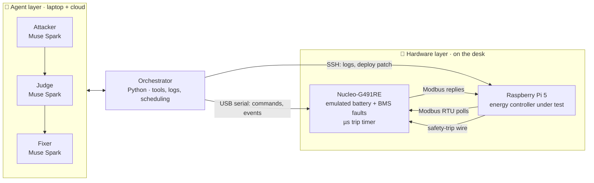
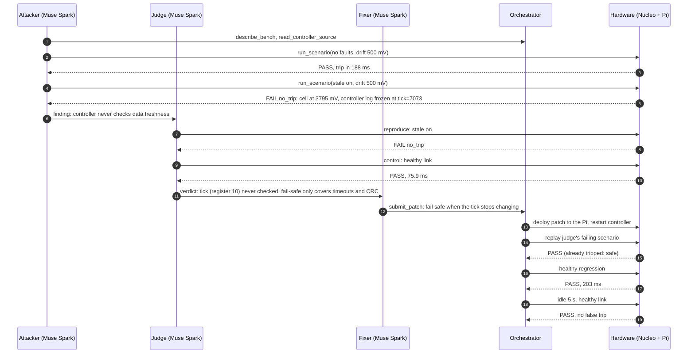
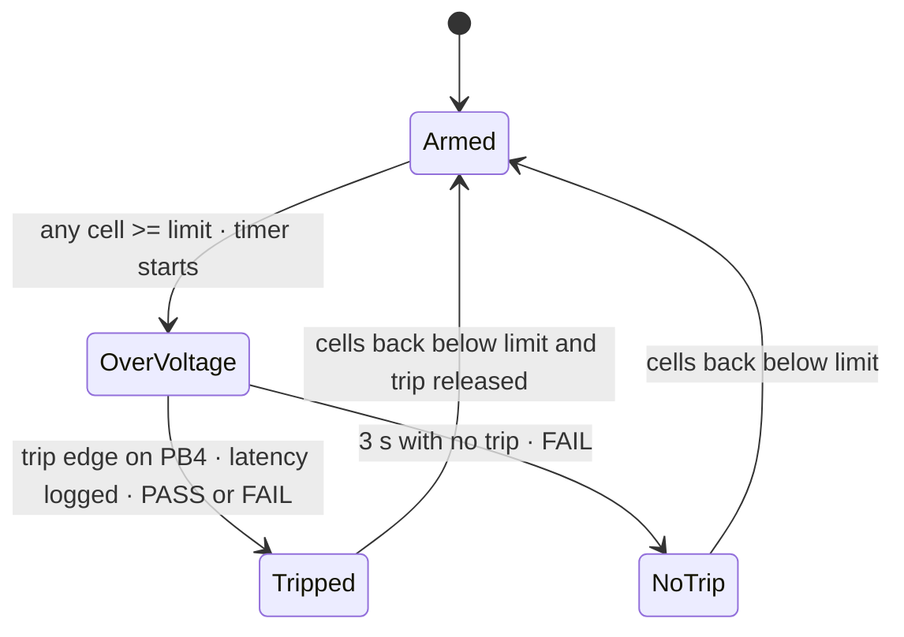

<div align="center">

# ⚡ GridTwin-HIL

### AI agents that crash-test energy controllers on real hardware

A $20 STM32 pretends to be a battery, inverter and grid. Meta's Muse models attack a real
Raspberry Pi energy controller, time its safety response to the microsecond, and fix the bugs they find.


*Built for the Meta Global AI Developer Hackathon · Indie track · Theme: Push the Frontier (energy)*

<br>


<sub><b>The bench.</b> Nucleo-G491RE battery emulator (top) · Raspberry Pi 5 controller under test (right) · trip line and LED on the breadboard (left). No battery, no mains, nothing dangerous: the danger is emulated.</sub>

</div>

---

## The problem

Every home battery, solar inverter and EV charger is run by a **controller**: software that reads the
battery and must cut power the moment something goes wrong. Testing that software is the hard part:

- You can't safely over-charge a real 48 V lithium battery bank just to see if your code reacts in time.
- Professional **hardware-in-the-loop (HIL)** rigs that fake a battery electrically cost tens of thousands of dollars.
- So most small energy teams test against mocks, and find the timing bugs in the field, when a
  contactor burns or a battery goes offline at 2 AM.

## The idea

Turn a cheap microcontroller into a **crash-test dummy battery**, and let AI agents drive the crashes.

| | Role | In one line |
|---|---|---|
| 🔋 | **Nucleo-G491RE** | Emulates the battery, inverter and grid over Modbus, and measures every safety trip with a hardware timer |
| 🧠 | **Raspberry Pi 5** | The real controller under test, exactly as it would run in the field |
| 🤖 | **Muse agents** | Design nasty scenarios, judge the results from hard evidence, and patch the controller |

The AI decides **what to test, why it failed and how to fix it**. The microcontroller decides
**whether it actually passed**, with a measurement the AI can't argue with.

---

## Architecture



**Why each link exists**

- **Modbus RTU over UART** is the same protocol real battery BMSs and inverters speak, so the
  controller code under test is the code you would ship.
- **The trip wire is physical.** The Pi raises a GPIO pin; the Nucleo timestamps the edge in an
  interrupt with a 1 MHz hardware counter. No Linux scheduler, no network, no guessing.
- **The orchestrator is ordinary Python.** It gives the agents a small set of tools and keeps a log of
  every run, so every claim in a report traces back to a measurement.

---

## A real run, start to finish

This is an unedited run from `runs/20261103-153422/`: three Muse Spark agents found a real safety bug
in the controller, proved its cause, fixed it, and the fix was verified on the hardware.
About 41k tokens in total.



| # | Who | Scenario or action | Hardware verdict |
|---|---|---|---|
| 1 | Attacker | Healthy baseline, drift 500 mV | ✅ PASS · 188.0 ms |
| 2 | Attacker | **Stale BMS data**, drift 500 mV | ❌ FAIL · no trip in 3000 ms (real cell 3795 mV) |
| 3 | Judge | Reproduce: stale data | ❌ FAIL · no trip |
| 4 | Judge | Control: healthy link | ✅ PASS · 75.9 ms |
| 5 | Fixer | Patch: track the tick, trip if it stops changing for 3 polls or 0.5 s | — |
| 6 | Verify | Judge's failing scenario, patched controller | ✅ PASS · tripped before the over-voltage |
| 7 | Verify | Healthy regression | ✅ PASS · 203.4 ms |
| 8 | Verify | Healthy link at idle for 5 s | ✅ PASS · no false trip |

**The judge's root cause, in its own words:** *"Controller trusts cell voltages without checking
freshness counter (reg 10 tick) or other liveness. Frozen Modbus replies with valid CRC blind it to
real over-voltage; error-counter fail-safe only covers timeouts/CRC, so stale never trips."*

Everything the agents saw and did is saved in the run folder: every scenario with its hypothesis,
every tool call, the verdict, the [patch](runs/20261103-153422/patch_1.diff) and the verification results.

---

## How the Muse models are used

| Agent | Model | Access | Its job | Tools |
|---|---|---|---|---|
| **Attacker** | Muse Spark `muse-spark-1.3` | Meta Model API, Responses API | Reads the controller's code and the bench's safety rule, forms hypotheses, and spends a small budget of hardware runs to find a failure | `describe_bench`, `read_controller_source`, `run_scenario`, `submit_finding` |
| **Judge** | Muse Spark (separate session) | Meta Model API (switchable to Muse Spark Open on Baseten) | Does not trust the attacker: reproduces the failure, runs controls, finds the minimal failing scenario and the responsible code | `describe_bench`, `read_controller_source`, `run_scenario`, `submit_verdict` |
| **Fixer** | Muse Spark | Meta Model API | Writes the complete patched controller from the judge's verdict. It never tests its own work | `submit_patch` |

**Why Muse Spark fits:** the attacker and judge have to plan across several tool calls, each of which costs
~10 s of real hardware time, so they need to reason before acting. The Responses API keeps the model's
reasoning across tool turns (`previous_response_id`), and each agent ends by calling a `submit_*` tool,
so its output is structured JSON the orchestrator can check rather than free text.

**Why three separate agents:** the one that designs the attack is not the one that judges it, and the one that
writes the fix never grades it. The final verdict always comes from the hardware.

<details>
<summary><b>🔧 The tools the agents can call</b></summary>

<br>

Agents never touch the hardware directly. They call a small set of tools the orchestrator exposes,
and every call is logged.

| Tool | Does | Safety rule |
|---|---|---|
| `describe_bench()` | Register map, the safety rule, the fault library and how a run works | Read-only |
| `read_controller_source()` | The controller under test | Read-only |
| `run_scenario(faults, drift_mv, charge_a, hypothesis)` | Resets the bench, applies faults, pushes cell 4 over the limit, returns the STM32's hardware-timed verdict, link statistics and the controller's log | Only 4 faults (`stale`, `delay`, `drop`, `crc`), ranges checked in Python **and** in firmware; a fixed scenario budget per agent |
| `submit_finding` / `submit_verdict` / `submit_patch` | Ends the agent's turn with structured JSON | A patch must compile and keep the CLI before it reaches the Pi |

After a patch, the **orchestrator**, not an agent, deploys it to the Pi over SSH and replays the judge's
failing scenario, a healthy regression and an idle false-trip check. If any check fails, the fixer gets the
results and one more attempt.

</details>

<details>
<summary><b>📡 Example: a function-calling request to Muse Spark</b></summary>

<br>

The agents call Muse Spark through the Responses API with function tools. The core of the loop in
[`agents/llm.py`](agents/llm.py), trimmed:

```python
client = OpenAI(base_url="https://api.meta.ai/v1", api_key=os.environ["MODEL_API_KEY"])

resp = client.responses.create(model="muse-spark-1.3", instructions=ATTACKER,
                               input="Find a condition under which this controller fails its trip.",
                               tools=specs)
while True:
    calls = [o for o in resp.output if o.type == "function_call"]
    if not calls:
        break
    outputs = [{"type": "function_call_output", "call_id": c.call_id,
                "output": json.dumps(run_tool(c.name, c.arguments))} for c in calls]
    resp = client.responses.create(model="muse-spark-1.3", previous_response_id=resp.id,
                                   tools=specs, input=outputs)
```

Model IDs and endpoints live in `.env` (see `.env.example`), so swapping a model is a config change.

</details>

---

## Inside the battery emulator

The Nucleo runs a small physics model, ten times a second, at 60× real time:

- **4 LiFePO4 cells, 100 Ah**, with a realistic open-circuit voltage curve: flat in the middle, steep near full.
- **Internal resistance** (voltage jumps with current) and **heating** (I²R in, cooling to ambient out).
- A **charge-current limit** the controller can write over Modbus, so its decisions change the physics.
- A **potentiometer** on the desk pushes cell 4 towards over-voltage by hand, for live demos.



Each trip is reported as three numbers, so a slow result explains itself:

| Measurement | Meaning |
|---|---|
| `latency_us` | Over-voltage to trip edge: the number that matters |
| `until_reported_us` | Over-voltage to the first Modbus reply carrying the bad value: the cost of the polling rate |
| `reaction_us` | That reply to the trip edge: Modbus transfer plus the controller's own processing |

<details>
<summary><b>🗺️ Modbus register map (slave address 1)</b></summary>

<br>

| Reg | Meaning | Unit |
|---|---|---|
| 0–3 | Cell 1–4 voltage | mV |
| 4 | Pack voltage | 10 mV |
| 5 | Pack current (+ = charging) | 0.1 A, signed |
| 6 | Temperature | 0.1 °C |
| 7 | State of charge | 0.1 % |
| 8 | Grid voltage | V |
| 9 | Status (bit 0 trip line high, bit 1 drift from knob) | |
| 10 | Simulation tick (+1 every 100 ms) | |
| 11 | Charge current limit, **writable** (function 0x06) | 0.1 A |

</details>

<details>
<summary><b>🔌 Wiring</b></summary>

<br>

Both boards use 3.3 V logic and connect directly. Each board is powered by its own USB.

| From | To | Purpose |
|---|---|---|
| Pi pin 8 (GPIO14, TX) | Nucleo PC5 (D0) | Modbus, Pi → Nucleo |
| Pi pin 10 (GPIO15, RX) | Nucleo PC4 (D1) | Modbus, Nucleo → Pi |
| Pi pin 6 (GND) | Nucleo GND | Shared ground |
| Pi pin 16 (GPIO23) | Nucleo PB4 (D5) | Safety-trip line |
| Trip line | 330 Ω → red LED → GND | Visible trip |
| Trip line | 10 kΩ → GND | Pull-down, no false trips at boot |
| Potentiometer | 3V3 / PA0 (A0) / GND | Manual cell drift |

</details>

---

## Repository layout

```
gridtwin/
├── firmware/      STM32CubeIDE project for the Nucleo-G491RE
│   └── Core/Src/gridtwin_app.c    battery model, Modbus slave, trip timer
├── pi/            controller.py, the controller under test
├── laptop/        monitor.py, live view and commands over USB
├── agents/        gridtwin.py (orchestrator), bench.py (hardware tools), llm.py (tool-calling loop)
├── runs/          every agent run: scenarios, tool calls, verdict, patch, verification
└── docs/          setup guides
```

## Quick start

<details>
<summary><b>1 · Flash the Nucleo</b></summary>

<br>

Open `firmware/` in STM32CubeIDE (**File → STM32 Project Create/Import → STM32CubeMX/STM32CubeIDE Project**),
build, and run. The green LED blinks twice a second when the firmware is alive.
Full peripheral settings: [docs/day1-setup.md](docs/day1-setup.md).

</details>

<details>
<summary><b>2 · Watch the battery from your laptop</b></summary>

<br>

```bash
python -m venv .venv
.venv\Scripts\activate          # Linux/macOS: source .venv/bin/activate
pip install -r requirements.txt
python laptop/monitor.py --port COM5     # or /dev/ttyACM0
```

Try `soc 90`, `i 80`, `drift 300`, then `drift 0`. Type `help` for every command.

</details>

<details>
<summary><b>3 · Run the controller on the Pi</b></summary>

<br>

Enable the UART (`dtparam=uart0=on`, serial console off), then:

```bash
git clone https://github.com/SujahathMSM/gridtwin.git && cd gridtwin
python3 pi/controller.py --poll-ms 200
```

Turn the knob up until cell 4 crosses 3650 mV: the LED lights, and the laptop monitor prints the
measured trip latency with PASS or FAIL.

</details>

<details>
<summary><b>4 · Run the agents</b></summary>

<br>

Copy `.env.example` to `.env` and set `MODEL_API_KEY`, `NUCLEO_PORT` and `PI_SSH`
(an SSH host the laptop can reach without a password). Close the monitor and stop the Pi controller:
the orchestrator runs it itself.

```bash
python agents/gridtwin.py --scenario healthy   # bench check, no AI: expect PASS
python agents/gridtwin.py --scenario stale     # bench check, no AI: expect FAIL no_trip
python agents/gridtwin.py                      # attacker -> judge -> fixer -> hardware verification
python agents/gridtwin.py --reset              # put the original controller back on the Pi
```

</details>

---

## Built during the hackathon

- [x] Battery emulator firmware: LiFePO4 model, Modbus RTU slave, microsecond trip timer, link diagnostics
- [x] Fault library in firmware: stale data, slow replies, lost replies, corrupted CRC
- [x] Pi controller under test and laptop monitor
- [x] Orchestrator with bounded hardware tools, SSH deploy and full run logs
- [x] Attacker, judge and fixer agents on Muse Spark, verified end to end on hardware
- [ ] Next: a fast-polling regression check, more fault types (grid sag, split frames), a live dashboard

## Results

### Day 1 · first measured trips

Controller polling every 200 ms over Modbus RTU at 9600 baud; over-voltage limit 3650 mV; deadline 500 ms.

| Trip | Total latency | Waiting for the next poll | Reply transfer + Pi processing | Result |
|---|---|---|---|---|
| 1 | **95.5 ms** | 61.8 ms | 33.7 ms | ✅ PASS |
| 2 | **203.5 ms** | 169.8 ms | 33.7 ms | ✅ PASS |

**First finding:** the 33.7 ms reaction is almost exactly the time a 29-byte reply takes at 9600 baud
(about 33 ms), so the Pi's own processing is under a millisecond. Trip latency is dominated by the
**polling interval and the serial link**, not the controller code: worst case ≈ 200 + 34 ≈ 234 ms.

The bench also caught a real failure: with the trip wire disconnected, the Pi believed it had tripped,
but the Nucleo saw no trip and scored it **FAIL**. The judge trusts the wire, not the controller's log.

More results go here as the agents start running scenarios.

---

<div align="center">
<sub>Built by <a href="https://github.com/SujahathMSM">Sujahath</a> in Sri Lanka · backend/DevOps engineer who has shipped Modbus battery and inverter software on Raspberry Pi</sub>
</div>
