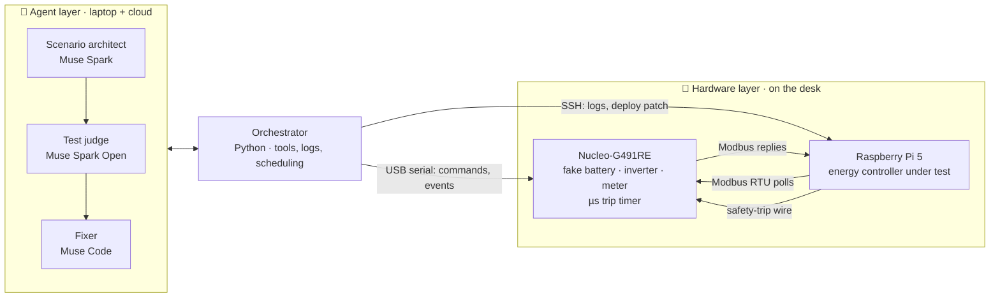
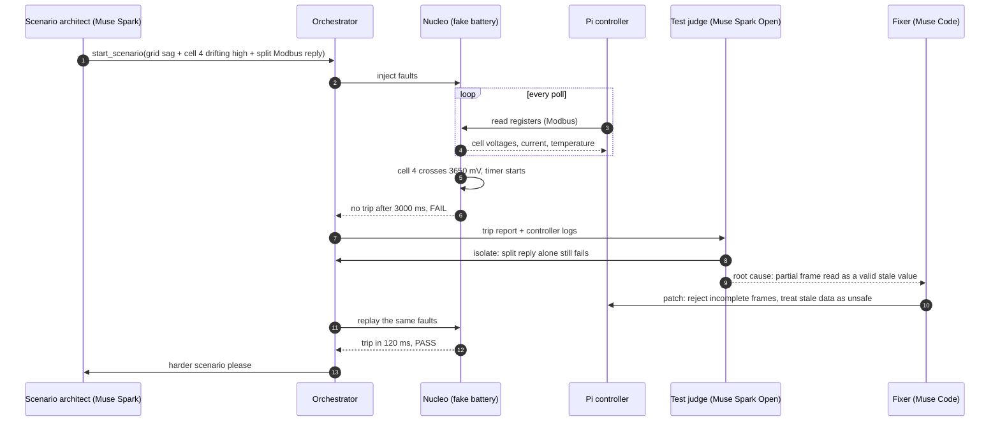
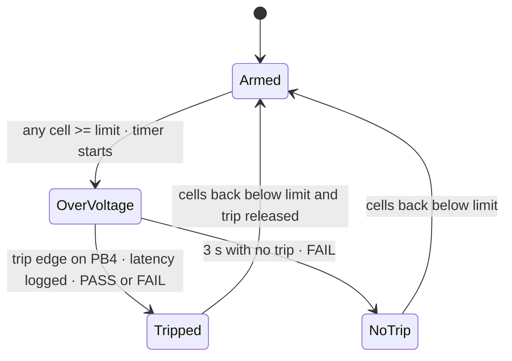

<div align="center">

# ⚡ GridTwin-HIL

### AI agents that crash-test energy controllers on real hardware

A $20 STM32 pretends to be a battery, inverter and grid. Meta's Muse models attack a real
Raspberry Pi energy controller, time its safety response to the microsecond, and fix the bugs they find.


*Built for the Meta Global AI Developer Hackathon · Indie track · Theme: Push the Frontier (energy)*

</div>

---

## The problem

Every home battery, solar inverter and EV charger is run by a **controller**: software that reads the
battery and must cut power the moment something goes wrong. Testing that software is the hard part:

- You can't safely over-charge a real 48 V lithium battery bank just to see if your code reacts in time.
- Professional **hardware-in-the-loop (HIL)** rigs that fake a battery electrically cost tens of thousands of dollars.
- So most small energy teams test against mocks, and find the timing bugs in the field, when a
  contactor burns or a battery goes offline at 2 AM.

## The idea

Turn a cheap microcontroller into a **crash-test dummy battery**, and let AI agents drive the crashes.

| | Role | In one line |
|---|---|---|
| 🔋 | **Nucleo-G491RE** | Emulates the battery, inverter and grid over Modbus, and measures every safety trip with a hardware timer |
| 🧠 | **Raspberry Pi 5** | The real controller under test, exactly as it would run in the field |
| 🤖 | **Muse agents** | Design nasty scenarios, judge the results from hard evidence, and patch the controller |

The AI decides **what to test, why it failed and how to fix it**. The microcontroller decides
**whether it actually passed**, with a measurement the AI can't argue with.

---

## Architecture



**Why each link exists**

- **Modbus RTU over UART** is the same protocol real battery BMSs and inverters speak, so the
  controller code under test is the code you would ship.
- **The trip wire is physical.** The Pi raises a GPIO pin; the Nucleo timestamps the edge in an
  interrupt with a 1 MHz hardware counter. No Linux scheduler, no network, no guessing.
- **The orchestrator is ordinary Python.** It gives the agents a small set of tools and keeps a log of
  every run, so every claim in a report traces back to a measurement.

---

## One test run



*(The scenario above is the target behaviour for the finished agents; day 1 runs the hardware half.)*

---

## How the Muse models are used

| Agent | Model | Access | Why this model |
|---|---|---|---|
| **Scenario architect** | Muse Spark | Meta Model API | Reads the controller code and its safety rules, then combines fault building blocks into scenarios. Needs strong reasoning and **function calling**. |
| **Test judge** | Muse Spark Open | Open weights, served on Baseten or Modal | Analyses every run, narrows a failure to the smallest scenario that still breaks the controller. Independent of the model that designs the attacks. |
| **Fixer** | Muse Code | Meta coding agent | Writes the patch to the Pi controller. It never grades its own work: the judge re-runs the attack. |
| *Optional:* voice | Muse Voice Transcribe | Meta Model API | Speak a scenario ("test a stuck contactor during a grid drop") instead of typing it. |

<details>
<summary><b>🔧 The tools the agents can call</b></summary>

<br>

Agents never touch the hardware directly. They call a small set of tools the orchestrator exposes,
and every call is logged.

| Tool | Does | Safety rule |
|---|---|---|
| `start_scenario(spec)` | Loads a combination of faults onto the Nucleo | Only faults from a fixed library; no free-form firmware |
| `inject_fault(kind, params)` | One fault: `cell_drift`, `grid_sag`, `stale_reply`, `split_frame`, `slow_reply`, `bad_crc` | Bounded parameter ranges, checked in firmware |
| `read_trip_report(run_id)` | Measured latency, PASS/FAIL, timestamps | Read-only, produced by the Nucleo |
| `read_controller_logs(run_id)` | The Pi controller's log for that run | Read-only |
| `propose_patch(diff)` | Fixer submits a change to `pi/controller.py` | Applied on a branch, never to `main` |
| `rerun(run_id)` | Replays the exact same faults | The only way a fix counts as passed |

</details>

<details>
<summary><b>📡 Example: a function-calling request to Muse Spark</b></summary>

<br>

The architect calls Muse Spark through the Meta Model API's chat-completions endpoint with `tools`.
A trimmed example of asking it for the next scenario:

```python
from openai import OpenAI   # chat-completions style client
import os

client = OpenAI(base_url="https://api.meta.ai/v1", api_key=os.environ["META_API_KEY"])

tools = [{
    "type": "function",
    "function": {
        "name": "start_scenario",
        "description": "Run a fault scenario on the hardware battery emulator",
        "parameters": {
            "type": "object",
            "properties": {
                "faults": {"type": "array", "items": {"type": "object"}},
                "duration_s": {"type": "number", "maximum": 60},
            },
            "required": ["faults"],
        },
    },
}]

resp = client.chat.completions.create(
    model=os.environ["MUSE_SPARK_MODEL"],
    messages=[
        {"role": "system", "content": "You design tests that break battery controllers safely."},
        {"role": "user", "content": "Last run: trip in 180 ms at 200 ms polling. Find a weakness."},
    ],
    tools=tools,
)
```

Model IDs and endpoints live in `.env` (see `.env.example`), so swapping a model is a config change.

</details>

---

## Inside the battery emulator

The Nucleo runs a small physics model, ten times a second, at 60× real time:

- **4 LiFePO4 cells, 100 Ah**, with a realistic open-circuit voltage curve: flat in the middle, steep near full.
- **Internal resistance** (voltage jumps with current) and **heating** (I²R in, cooling to ambient out).
- A **charge-current limit** the controller can write over Modbus, so its decisions change the physics.
- A **potentiometer** on the desk pushes cell 4 towards over-voltage by hand, for live demos.



Each trip is reported as three numbers, so a slow result explains itself:

| Measurement | Meaning |
|---|---|
| `latency_us` | Over-voltage to trip edge: the number that matters |
| `until_reported_us` | Over-voltage to the first Modbus reply carrying the bad value: the cost of the polling rate |
| `reaction_us` | That reply to the trip edge: Modbus transfer plus the controller's own processing |

<details>
<summary><b>🗺️ Modbus register map (slave address 1)</b></summary>

<br>

| Reg | Meaning | Unit |
|---|---|---|
| 0–3 | Cell 1–4 voltage | mV |
| 4 | Pack voltage | 10 mV |
| 5 | Pack current (+ = charging) | 0.1 A, signed |
| 6 | Temperature | 0.1 °C |
| 7 | State of charge | 0.1 % |
| 8 | Grid voltage | V |
| 9 | Status (bit 0 trip line high, bit 1 drift from knob) | |
| 10 | Simulation tick (+1 every 100 ms) | |
| 11 | Charge current limit, **writable** (function 0x06) | 0.1 A |

</details>

<details>
<summary><b>🔌 Wiring</b></summary>

<br>

Both boards use 3.3 V logic and connect directly. Each board is powered by its own USB.

| From | To | Purpose |
|---|---|---|
| Pi pin 8 (GPIO14, TX) | Nucleo PC5 (D0) | Modbus, Pi → Nucleo |
| Pi pin 10 (GPIO15, RX) | Nucleo PC4 (D1) | Modbus, Nucleo → Pi |
| Pi pin 6 (GND) | Nucleo GND | Shared ground |
| Pi pin 16 (GPIO23) | Nucleo PB4 (D5) | Safety-trip line |
| Trip line | 330 Ω → red LED → GND | Visible trip |
| Trip line | 10 kΩ → GND | Pull-down, no false trips at boot |
| Potentiometer | 3V3 / PA0 (A0) / GND | Manual cell drift |

</details>

---

## Repository layout

```
gridtwin/
├── firmware/      STM32CubeIDE project for the Nucleo-G491RE
│   └── Core/Src/gridtwin_app.c    battery model, Modbus slave, trip timer
├── pi/            controller.py, the controller under test
├── laptop/        monitor.py, live view and commands over USB
├── agents/        Muse agents and orchestrator (in progress)
└── docs/          setup guides
```

## Quick start

<details>
<summary><b>1 · Flash the Nucleo</b></summary>

<br>

Open `firmware/` in STM32CubeIDE (**File → STM32 Project Create/Import → STM32CubeMX/STM32CubeIDE Project**),
build, and run. The green LED blinks twice a second when the firmware is alive.
Full peripheral settings: [docs/day1-setup.md](docs/day1-setup.md).

</details>

<details>
<summary><b>2 · Watch the battery from your laptop</b></summary>

<br>

```bash
python -m venv .venv
.venv\Scripts\activate          # Linux/macOS: source .venv/bin/activate
pip install -r requirements.txt
python laptop/monitor.py --port COM5     # or /dev/ttyACM0
```

Try `soc 90`, `i 80`, `drift 300`, then `drift 0`. Type `help` for every command.

</details>

<details>
<summary><b>3 · Run the controller on the Pi</b></summary>

<br>

Enable the UART (`dtparam=uart0=on`, serial console off), then:

```bash
git clone https://github.com/SujahathMSM/gridtwin.git && cd gridtwin
python3 pi/controller.py --poll-ms 200
```

Turn the knob up until cell 4 crosses 3650 mV: the LED lights, and the laptop monitor prints the
measured trip latency with PASS or FAIL.

</details>

---

## Roadmap

- [x] **Day 1** · Battery emulator, Modbus slave, microsecond trip timer, Pi controller, laptop monitor
- [ ] **Day 2** · Fault library on the Nucleo: stale and split replies, slow replies, bad CRC, grid sag
- [ ] **Day 3** · Orchestrator with logged tool calls
- [ ] **Day 4** · Scenario architect on Muse Spark
- [ ] **Day 5** · Test judge on Muse Spark Open, failure minimisation
- [ ] **Day 6** · Fixer on Muse Code, patch then re-run loop
- [ ] **Day 7** · Live dashboard and demo video

## Results

Measured numbers go here as they come in: trip latency against polling rate, scenarios that broke
the controller, and the fixes that held.

---

<div align="center">
<sub>Built by <a href="https://github.com/SujahathMSM">Sujahath</a> in Sri Lanka · backend/DevOps engineer who has shipped Modbus battery and inverter software on Raspberry Pi</sub>
</div>
