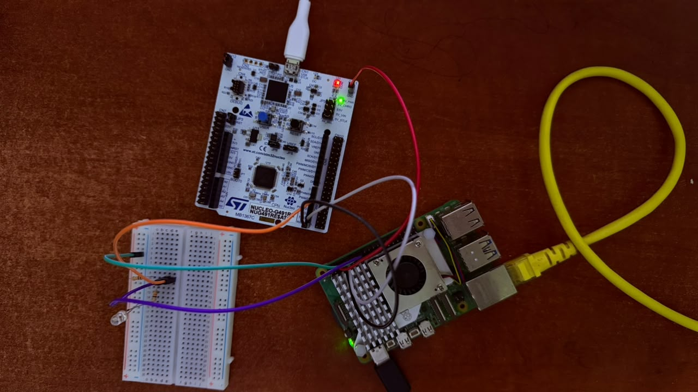
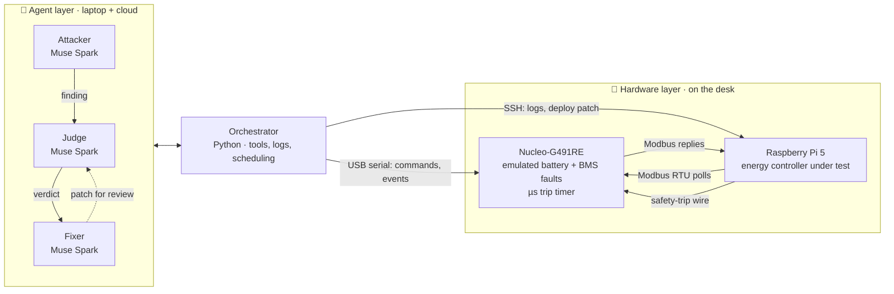
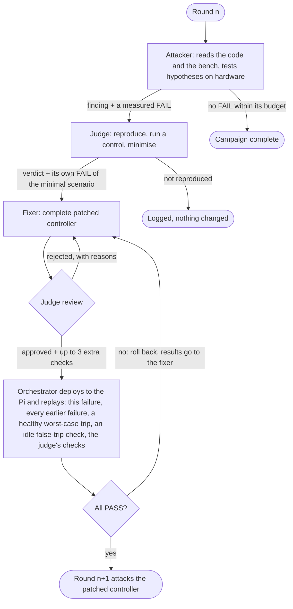
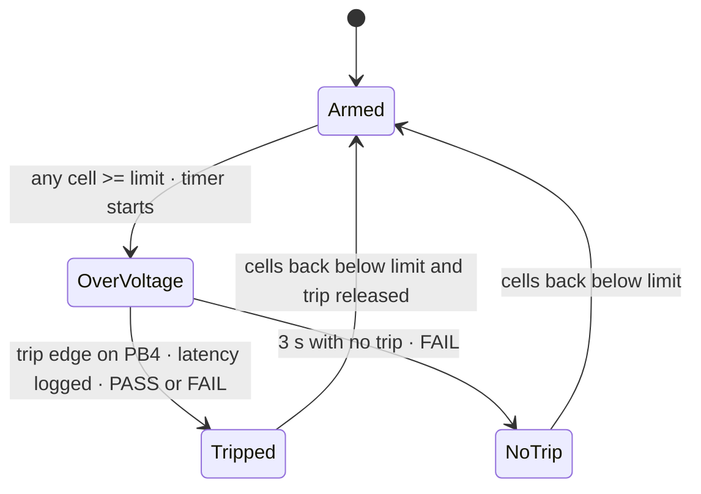

<div align="center">

# ⚡ GridTwin-HIL

### AI agents that crash-test energy controllers on real hardware

A $20 STM32 pretends to be a battery, inverter and grid. Meta's Muse Spark agents attack a real
Raspberry Pi energy controller, prove each failure with a microsecond hardware timer, fix it,
and then attack their own fix.


*Built for the Meta Global AI Developer Hackathon · Indie track · Theme: Push the Frontier (energy)*

<br>



<sub><b>The bench.</b> Nucleo-G491RE battery emulator (top) · Raspberry Pi 5 controller under test (right) · trip line and LED on the breadboard (left). No battery, no mains, nothing dangerous: the danger is emulated.</sub>

</div>

---

## The problem

Every home battery, solar inverter and EV charger is run by a **controller**: software that reads the
battery and must cut power the moment something goes wrong. Testing that software is the hard part:

- You can't safely over-charge a real 48 V lithium battery bank just to see if your code reacts in time.
- Professional **hardware-in-the-loop (HIL)** rigs that fake a battery electrically cost tens of thousands of dollars.
- So most small energy teams test against mocks, and find the timing bugs in the field, when a
  contactor burns or a battery goes offline at 2 AM.

## The idea

Turn a cheap microcontroller into a **crash-test dummy battery**, and let AI agents drive the crashes.

| | Role | In one line |
|---|---|---|
| 🔋 | **Nucleo-G491RE** | Emulates the battery, inverter and grid over Modbus, and measures every safety trip with a hardware timer |
| 🧠 | **Raspberry Pi 5** | The real controller under test, exactly as it would run in the field |
| 🤖 | **Muse agents** | Design nasty scenarios, judge the results from hard evidence, and patch the controller |

The AI decides **what to test, why it failed and how to fix it**. The microcontroller decides
**whether it actually passed**, with a measurement the AI can't argue with.

---

## Architecture



**Why each link exists**

- **Modbus RTU over UART** is the same protocol real battery BMSs and inverters speak, so the
  controller code under test is the code you would ship.
- **The trip wire is physical.** The Pi raises a GPIO pin; the Nucleo timestamps the edge in an
  interrupt with a 1 MHz hardware counter. No Linux scheduler, no network, no guessing.
- **The orchestrator is ordinary Python.** It gives the agents a small set of tools and keeps a log of
  every run, so every claim in a report traces back to a measurement.

---

## The campaign: three bugs found, proven, fixed, and re-attacked

An unedited run from [`runs/20261103-175501/`](runs/20261103-175501/). The agents started from the
original controller with **no hints about any bug**. Each round attacks the controller *as patched by the
previous round*, so the agents end up attacking their own fixes.

**3 rounds · 45 hardware runs · 9 measured failures · 3 fixes, each accepted on the first attempt ·
21 of 21 verification checks passed · 44.7 minutes · ~415k tokens across 12 Muse Spark sessions**

| Round | What the attacker found | Measured on hardware | Fix | After the fix |
|---|---|---|---|---|
| **1** | The controller never checks the BMS freshness counter, so frozen data hides a real over-voltage | ❌ **no trip in 3 s** (real cell 3795 mV), 4 of 4 runs | Trip if the tick stops changing for 0.35 s | ✅ trips before the cell crosses the limit |
| **2** | At the slowest allowed polling (500 ms) a **healthy** link misses the 500 ms deadline | ❌ **503.4 ms**, 3 of 3 runs | Cap the safety-check period at 400 ms | ✅ **403.3 ms** |
| **3** | Two dropped replies in a row at a 220 ms poll delay the fail-safe past the deadline | ❌ **547.3 ms** | Fail safe on the first missed reply, 50 ms serial timeout | ✅ trips safely |



### Round 2 is the best part: the attacker caught the fixer's own claim

The round 1 patch carried this comment: *"short enough that detection + trip <= 500ms for poll 50-500ms"*.
The round 2 attacker read it and didn't believe it. It ran the controller at the edge of its deployment
range with **no faults at all**, using worst-case timing:

| Who | Poll | Hardware verdict |
|---|---|---|
| Attacker | 200 ms | ✅ PASS · 203.4 ms (control) |
| Attacker | 500 ms | ❌ **FAIL · 503.4 ms** |
| Attacker | 400 ms | ✅ PASS · 403.4 ms (control) |
| Attacker | 500 ms | ❌ **FAIL · 503.4 ms** (repeat) |
| Judge | 500 ms | ❌ **FAIL · 503.2 ms** (independent reproduction) |
| Judge | 400 ms | ✅ PASS · 403.3 ms |
| Judge | 450 ms | ✅ PASS · 453.3 ms (narrowing down where it breaks) |

**The judge's root cause:** *"Worst-case OV occurring right after a reply is invisible until next read
completes, so detection latency ≈ poll_ms + read/processing overhead. At max allowed poll_ms=500 this is
~469 ms until reported + 33.6 ms reaction = 503 ms > 500 ms deadline."*

This is a real class of bug: the code is correct, the configuration range is not.

### Round 3: an attack nobody suggested

With the controller now hardened against stale data and slow polling, the attacker went for **burst loss**.
It worked out that at a 220 ms poll, one dropped reply leaves a ~340 ms gap, just under the 0.35 s fail-safe
timer, while **two** dropped replies push the trip to 547 ms. It chose the polling rate to land in that gap.
The drop fault is random, so the judge's first reproduction passed. It ran the scenario again, measured the
FAIL itself, then ran a healthy control at the same rate (✅ 223.4 ms) to prove the drops were the cause.

<details>
<summary><b>📂 Everything in the run folder</b></summary>

<br>

| File | Contents |
|---|---|
| `scenarios.json` | All 45 hardware runs: scenario, hypothesis, verdict, latency split, link stats, controller log |
| `round{n}_attacker.json`, `round{n}_judge.json` | Every tool call and result, the final finding or verdict, and the **hardware evidence** (the measured FAILs it rests on) |
| `round{n}_patch_1.diff` | The fixer's patch: [round 1](runs/20261103-175501/round1_patch_1.diff) · [round 2](runs/20261103-175501/round2_patch_1.diff) · [round 3](runs/20261103-175501/round3_patch_1.diff) |
| `round{n}_review_1.json` | The judge's review and its extra hardware checks |
| `round{n}_verification_1.json` | Every verification check after deployment |
| `controller_final.py` | The controller after three rounds |
| `soak.log` | The final controller running for an hour (see Results) |

</details>

---

## Keeping the agents honest

An AI that can argue its way to a conclusion is a liability in safety testing. The rule here is simple:
**only the hardware decides**. It is enforced in code, not left to the prompts.

- **Evidence rule.** A finding that claims a failure is refused unless the attacker's own hardware runs
  include a FAIL. A judge verdict of `reproduced: true` is refused unless one of the **judge's** runs failed,
  and its minimal scenario must be *exactly* one it ran and saw fail. The orchestrator checks this again
  after the judge finishes and records the measured FAILs in the run log.
- **Worst-case timing.** Timing bugs depend on when the over-voltage lands relative to the controller's
  polling, which is normally random. With `timing: "worst_case"`, the STM32 raises the cell *right after it
  answers a read*, so the controller cannot see it before its next poll. A timing race becomes a repeatable
  measurement.
- **Separation of duties.** The attacker doesn't judge its finding, the fixer never tests its own patch, and the
  orchestrator chooses the verification checks.

**Why we added this:** in an earlier campaign
([`runs/20261103-164132`](runs/20261103-164132/)), the judge marked a slow-polling failure as reproduced
after **three runs that all passed**, arguing the passes were luck. Its reasoning turned out to be right, but
it had no measurement behind it. The evidence rule and worst-case timing came out of that. The same failure
is now measured at 503.4 ms every time.

---

## How the Muse models are used

| Agent | Model | Access | Its job | Tools |
|---|---|---|---|---|
| **Attacker** | Muse Spark `muse-spark-1.3` | Meta Model API, Responses API | Reads the controller's code and the bench's safety rule, forms hypotheses, and spends a small budget of hardware runs to find a failure | `describe_bench`, `read_controller_source`, `run_scenario`, `submit_finding` |
| **Judge** | Muse Spark (separate sessions) | Meta Model API | Does not trust the attacker: reproduces the failure, runs controls, finds the minimal failing scenario and the responsible code. Later **reviews the fixer's diff** before it reaches the Pi, and can reject it or add up to 3 hardware checks of its own | `describe_bench`, `read_controller_source`, `run_scenario`, `submit_verdict`, `submit_review` |
| **Fixer** | Muse Spark | Meta Model API | Writes the complete patched controller from the verdict and the history of earlier fixes. It never tests its own work | `submit_patch` |

The judge can be pointed at Muse Spark Open on Baseten (`JUDGE_PROVIDER=baseten`, Chat Completions)
with a config change. All runs shown here used `muse-spark-1.3` on the Meta Model API.

**Why Muse Spark fits:** the attacker and judge have to plan across several tool calls, each of which costs
~10 s of real hardware time, so they need to reason before acting. The Responses API keeps the model's
reasoning across tool turns (`previous_response_id`), and each agent ends by calling a `submit_*` tool,
so its output is structured JSON the orchestrator can check rather than free text.

**Why three separate agents:** the one that designs the attack is not the one that judges it, and the one that
writes the fix never grades it. The final verdict always comes from the hardware.

**What the attacker is told:** the bench description (register map, the two safety rules, the controller's
deployment range of 50–500 ms polling, the fault library) and the controller's source. It is never told
what is wrong. In the campaign below it opened every round with a healthy control run, without being asked to.

<details>
<summary><b>🔧 The tools the agents can call</b></summary>

<br>

Agents never touch the hardware directly. They call a small set of tools the orchestrator exposes,
and every call is logged.

| Tool | Does | Safety rule |
|---|---|---|
| `describe_bench()` | Register map, the two safety rules, the deployment range, the fault library, timing modes and how a run works | Read-only |
| `read_controller_source()` | The controller under test | Read-only |
| `run_scenario(faults, drift_mv, charge_a, poll_ms, timing, hypothesis)` | Resets the bench, restarts the controller at the requested polling rate, applies faults, pushes cell 4 up, returns the STM32's hardware-timed verdict, link statistics and the controller's log | Only 4 faults (`stale`, `delay`, `drop`, `crc`), ranges checked in Python **and** in firmware; polling clamped to 50–500 ms; a fixed scenario budget per agent (attacker 6, judge 4) |
| `submit_finding` / `submit_verdict` | Ends the agent's turn with structured JSON | **Refused** unless backed by a FAIL the agent measured itself (see *Keeping the agents honest*) |
| `submit_patch` / `submit_review` | The patch, then the judge's approve/reject with extra checks | A patch must compile and keep the CLI, then pass review, before it reaches the Pi |

After an approved patch, the **orchestrator**, not an agent, deploys it to the Pi over SSH and replays:
this round's failing scenario, **every earlier round's failure** (regression), a healthy over-voltage with
worst-case timing, a healthy idle false-trip check, and the judge's extra checks. All must PASS.
Otherwise the old controller is put back and the fixer gets the results, up to 3 attempts.

</details>

<details>
<summary><b>📡 Example: a function-calling request to Muse Spark</b></summary>

<br>

The agents call Muse Spark through the Responses API with function tools. The core of the loop in
[`agents/llm.py`](agents/llm.py), trimmed:

```python
client = OpenAI(base_url="https://api.meta.ai/v1", api_key=os.environ["MODEL_API_KEY"])

resp = client.responses.create(model="muse-spark-1.3", instructions=ATTACKER,
                               input="Find a condition under which this controller fails its trip.",
                               tools=specs)
while True:
    calls = [o for o in resp.output if o.type == "function_call"]
    if not calls:
        break
    outputs = [{"type": "function_call_output", "call_id": c.call_id,
                "output": json.dumps(run_tool(c.name, c.arguments))} for c in calls]
    resp = client.responses.create(model="muse-spark-1.3", previous_response_id=resp.id,
                                   tools=specs, input=outputs)
```

Model IDs and endpoints live in `.env` (see `.env.example`), so swapping a model is a config change.

</details>

---

## Inside the battery emulator

The Nucleo runs a small physics model, ten times a second, at 60× real time:

- **4 LiFePO4 cells, 100 Ah**, with a realistic open-circuit voltage curve: flat in the middle, steep near full.
- **Internal resistance** (voltage jumps with current) and **heating** (I²R in, cooling to ambient out).
- A **charge-current limit** the controller can write over Modbus, so its decisions change the physics.
- A **potentiometer** on the desk pushes cell 4 towards over-voltage by hand, for live demos.
- **Worst-case timing** (`drift sync <mV>`): the cell is raised the moment the last bit of a Modbus read
  reply leaves the STM32, the worst possible moment for a polling controller.



Each trip is reported as three numbers, so a slow result explains itself:

| Measurement | Meaning |
|---|---|
| `latency_us` | Over-voltage to trip edge: the number that matters |
| `until_reported_us` | Over-voltage to the first Modbus reply carrying the bad value: the cost of the polling rate |
| `reaction_us` | That reply to the trip edge: Modbus transfer plus the controller's own processing |

<details>
<summary><b>🗺️ Modbus register map (slave address 1)</b></summary>

<br>

| Reg | Meaning | Unit |
|---|---|---|
| 0–3 | Cell 1–4 voltage | mV |
| 4 | Pack voltage | 10 mV |
| 5 | Pack current (+ = charging) | 0.1 A, signed |
| 6 | Temperature | 0.1 °C |
| 7 | State of charge | 0.1 % |
| 8 | Grid voltage | V |
| 9 | Status (bit 0 trip line high, bit 1 drift from knob) | |
| 10 | Simulation tick (+1 every 100 ms) | |
| 11 | Charge current limit, **writable** (function 0x06) | 0.1 A |

</details>

<details>
<summary><b>🔌 Wiring</b></summary>

<br>

Both boards use 3.3 V logic and connect directly. Each board is powered by its own USB.

| From | To | Purpose |
|---|---|---|
| Pi pin 8 (GPIO14, TX) | Nucleo PC5 (D0) | Modbus, Pi → Nucleo |
| Pi pin 10 (GPIO15, RX) | Nucleo PC4 (D1) | Modbus, Nucleo → Pi |
| Pi pin 6 (GND) | Nucleo GND | Shared ground |
| Pi pin 16 (GPIO23) | Nucleo PB4 (D5) | Safety-trip line |
| Trip line | 330 Ω → red LED → GND | Visible trip |
| Trip line | 10 kΩ → GND | Pull-down, no false trips at boot |
| Potentiometer | 3V3 / PA0 (A0) / GND | Manual cell drift |

</details>

---

## Repository layout

```
gridtwin/
├── firmware/      STM32CubeIDE project for the Nucleo-G491RE
│   └── Core/Src/gridtwin_app.c    battery model, Modbus slave, trip timer
├── pi/            controller.py, the controller under test
├── laptop/        monitor.py, live view and commands over USB
├── agents/        gridtwin.py (orchestrator), bench.py (hardware tools), llm.py (tool-calling loop)
├── runs/          every agent run: scenarios, tool calls, verdict, patch, verification
└── docs/          setup guides
```

## Quick start

<details>
<summary><b>1 · Flash the Nucleo</b></summary>

<br>

Open `firmware/` in STM32CubeIDE (**File → STM32 Project Create/Import → STM32CubeMX/STM32CubeIDE Project**),
build, and run. The green LED blinks twice a second when the firmware is alive.
Full peripheral settings: [docs/day1-setup.md](docs/day1-setup.md).

</details>

<details>
<summary><b>2 · Watch the battery from your laptop</b></summary>

<br>

```bash
python -m venv .venv
.venv\Scripts\activate          # Linux/macOS: source .venv/bin/activate
pip install -r requirements.txt
python laptop/monitor.py --port COM5     # or /dev/ttyACM0
```

Try `soc 90`, `i 80`, `drift 300`, then `drift 0`. Faults: `fault stale on`, `fault drop 50`,
`fault clear`. Worst-case timing: `drift sync 400`. Type `help` for every command.

</details>

<details>
<summary><b>3 · Run the controller on the Pi</b></summary>

<br>

Enable the UART (`dtparam=uart0=on`, serial console off), then:

```bash
git clone https://github.com/SujahathMSM/gridtwin.git && cd gridtwin
python3 pi/controller.py --poll-ms 200
```

Turn the knob up until cell 4 crosses 3650 mV: the LED lights, and the laptop monitor prints the
measured trip latency with PASS or FAIL.

</details>

<details>
<summary><b>4 · Run the agents</b></summary>

<br>

Copy `.env.example` to `.env` and set `MODEL_API_KEY`, `NUCLEO_PORT` and `PI_SSH`
(an SSH host the laptop can reach without a password). Close the monitor and stop the Pi controller:
the orchestrator runs it itself.

```bash
python agents/gridtwin.py --scenario healthy   # bench check, no AI: expect PASS
python agents/gridtwin.py --scenario stale     # bench check, no AI: expect FAIL no_trip
python agents/gridtwin.py --scenario healthy --poll-ms 500 --timing worst_case   # expect FAIL ~503 ms
python agents/gridtwin.py                      # the campaign: up to 3 rounds of attack -> judge -> fix -> review -> verify
python agents/gridtwin.py --rounds 1           # a single round
python agents/gridtwin.py --reset              # put the original controller back on the Pi
```

</details>

---

## Built during the hackathon

- [x] Battery emulator firmware: LiFePO4 model, Modbus RTU slave, microsecond trip timer, link diagnostics
- [x] Fault library in firmware: stale data, slow replies, lost replies, corrupted CRC
- [x] Pi controller under test and laptop monitor
- [x] Orchestrator with bounded hardware tools, SSH deploy and full run logs
- [x] Attacker, judge and fixer agents on Muse Spark, verified end to end on hardware
- [x] Multi-round campaign: the attacker re-attacks each patched controller, with regression replay of every earlier failure
- [x] Judge reviews every patch before deployment and adds its own hardware checks
- [x] Evidence rule enforced in code, and a worst-case timing mode in firmware that makes timing races reproducible
- [x] Two safety rules (trip in time, no false trips) across the full 50–500 ms deployment range
- [ ] Next: longer soak tests inside the verification step, more fault types (grid sag, split frames), a live dashboard

## Results

### The campaign

See [the campaign](#the-campaign-three-bugs-found-proven-fixed-and-re-attacked) above: three distinct safety
failures, each measured on hardware by two independent agents, fixed and verified with 21 of 21 checks passing.

### One-hour soak of the final controller

The verification checks last seconds each. To check the final controller for false trips over a longer
period, it ran on a healthy link at the **fastest allowed polling (50 ms)**:

| Polls | Duration | Missed replies | Trips (false) |
|---|---|---|---|
| **76,600** | ~64 min | **0** | **0** |

During the soak the emulated battery charged itself full, so cell 4 sat at **3609 mV, only 41 mV under the
trip limit**, for most of the hour. Log: [`runs/20261103-175501/soak.log`](runs/20261103-175501/soak.log).

### Day 1 · first measured trips

Controller polling every 200 ms over Modbus RTU at 9600 baud; over-voltage limit 3650 mV; deadline 500 ms.

| Trip | Total latency | Waiting for the next poll | Reply transfer + Pi processing | Result |
|---|---|---|---|---|
| 1 | **95.5 ms** | 61.8 ms | 33.7 ms | ✅ PASS |
| 2 | **203.5 ms** | 169.8 ms | 33.7 ms | ✅ PASS |

The 33.7 ms reaction is almost exactly the time a 29-byte reply takes at 9600 baud, so the Pi's own
processing is a few milliseconds. On day 1 we estimated the worst case as poll + 34 ms. Worst-case timing
later measured it properly: **poll interval + ~3.5 ms** (203.5 ms at 200 ms polling, 503.4 ms at 500 ms).
The reply transfer overlaps the wait for the next poll.

The bench also caught a real failure on day 1: with the trip wire disconnected, the Pi believed it had
tripped, but the Nucleo saw no trip and scored it **FAIL**. The judge trusts the wire, not the controller's log.

### Known limitations

- **The round 3 fix is strict.** It trips on the first missed reply. That is safe, but on a real site with an
  occasionally noisy RS-485 line, every lost reply would cause a short nuisance trip until the next good read.
  A production controller would weigh that against the deadline, for example by retrying immediately once.
  The bench's rule 2 only defines false trips on a *healthy* link, so the agents optimised for that.
- **The 50 ms serial timeout leaves about 7 ms of margin** over a full reply at 9600 baud. The one-hour soak
  saw no misses, but a heavily loaded Pi could eat that margin.
- **Random faults reproduce randomly.** `drop` at 70 % reproduced the round 3 failure in 1 of 2 judge runs; the
  evidence rule only requires one measured FAIL. `stale` and worst-case timing reproduce every time.
- **One model family.** All agents ran on `muse-spark-1.3`. The open-weights judge path is implemented but
  was not used in these runs.

---

<div align="center">
<sub>Built by <a href="https://github.com/SujahathMSM">Sujahath</a> in Sri Lanka · backend/DevOps engineer who has shipped Modbus battery and inverter software on Raspberry Pi</sub>
</div>
